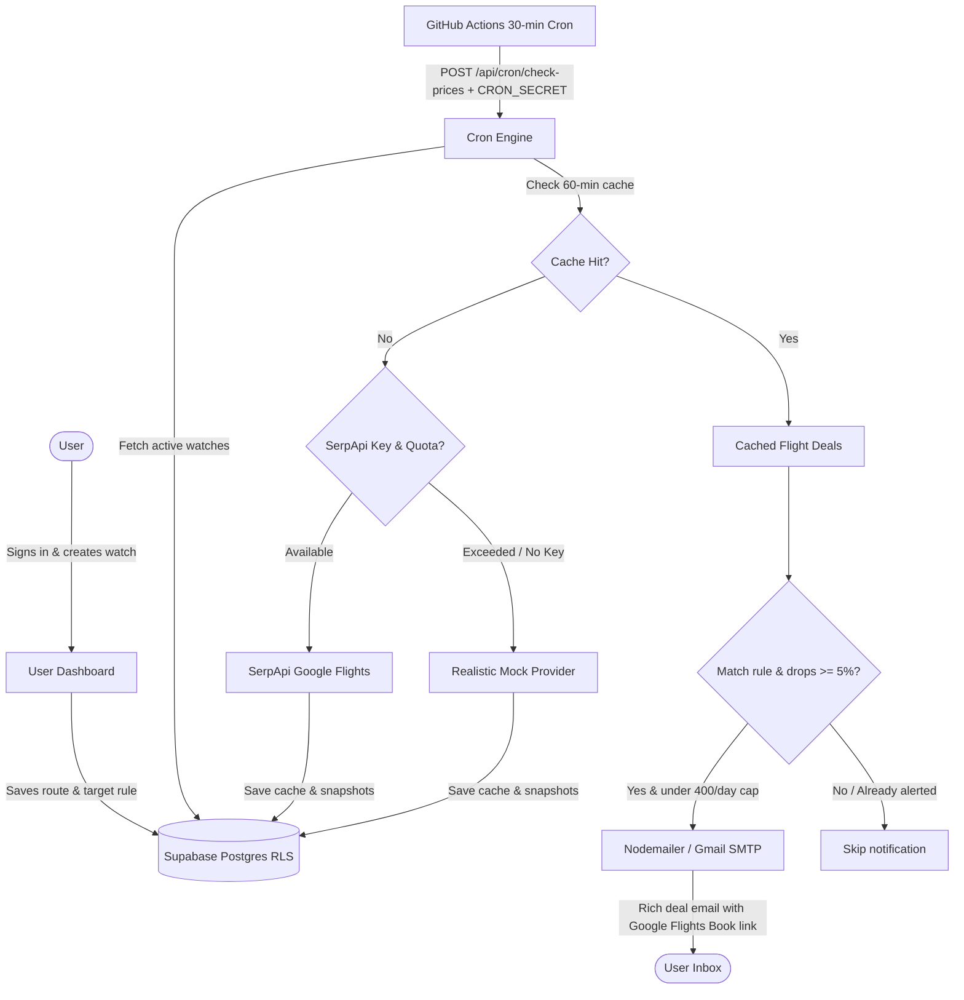

# FareWatch ✈️

> Automated flight price alert web app for domestic routes across India with multi-user isolation, real-time Google Flights tracking, and zero-spam email alerts.

[](LICENSE)
[](https://nextjs.org)
[](https://supabase.com)
[](https://tailwindcss.com)

---

## 🌐 Live Demo & Repository
- **Live Application:** [https://farewatch.vercel.app](https://farewatch.vercel.app)
- **GitHub Repository:** [https://github.com/khivyasajjan/farewatch](https://github.com/khivyasajjan/farewatch)

---

## 🎯 Key Features

- **Multi-User Isolation with RLS:** Every user authenticates securely via Google OAuth or Magic Link. Row-Level Security (RLS) ensures users only access their own flight watches.
- **5 Active Watches per User:** Generous allowance for upcoming business and leisure trips while preventing system abuse.
- **Searchable Indian Airports:** Autocomplete coverage of 40+ commercial domestic airports across India (BLR, DEL, BOM, HYD, MAA, CCU, GOI, PNQ, etc.).
- **Flexible Dates & Date Ranges:** Monitor a specific departure date or an entire flexible vacation window (e.g., Dec 1–15).
- **Target Price Rules:**
  - **Below ₹X:** Alert whenever any flight drops below your threshold.
  - **Between ₹X and ₹Y:** Target a specific budget corridor.
  - **Non-stop Only:** Filter out connecting flights when speed matters.
- **Zero-Spam Deduplication Engine:**
  - We never email the same flight at the same fare twice.
  - Re-alerts only trigger if the fare drops by **5% or more**.
  - Multiple matching flights are consolidated into a single clean email sorted cheapest first.
- **Smart 60-Minute Search Cache:** If multiple users watch the same route and travel date, only one API call is executed and shared.
- **Dual Flight Search Providers:**
  - **SerpApi Google Flights API:** Fetches live Indian domestic fares.
  - **Built-in Mock Provider:** Generates realistic INR fares with real Indian airlines (IndiGo, Air India, Akasa Air, SpiceJet) when running without API keys or for local testing.
  - **Budget Pacing:** Automatically throttles and protects the 250 monthly free SerpApi quota.
- **Visual Price History:** Interactive Recharts line graph with your target price line on the watch detail page.
- **Admin Dashboard:** Access-controlled metrics for total users, active watches, monthly SerpApi consumption, and daily email sends (capped at 400/day).
- **Automated 30-Minute Scheduler:** GitHub Actions workflow triggers the protected cron endpoint `/api/cron/check-prices` every 30 minutes.

---

## 🛠️ How It Works



---

## 📦 Tech Stack

| Layer | Technologies |
|---|---|
| **Framework** | [Next.js](https://nextjs.org/) (App Router) + [TypeScript](https://www.typescriptlang.org/) |
| **Styling & UI** | [Tailwind CSS](https://tailwindcss.com/) + [Lucide Icons](https://lucide.dev/) + Dark/Light Mode |
| **Charts** | [Recharts](https://recharts.org/) |
| **Database & Auth** | [Supabase](https://supabase.com/) (PostgreSQL + RLS + Auth + SQL Migrations) |
| **Flight Search** | [SerpApi](https://serpapi.com/) Google Flights API (`engine=google_flights`, `gl=in`, `currency=INR`) + Deterministic Mock Provider |
| **Email Transporter** | [Nodemailer](https://nodemailer.com/) (Gmail SMTP with Google App Password) |
| **Deployment** | [Vercel](https://vercel.com/) |
| **Scheduler** | [GitHub Actions](https://github.com/features/actions) (`*/30 * * * *`) |

---

## 📂 Project Structure

```text
farewatch/
├── .github/
│   └── workflows/
│       └── check-prices.yml      # 30-minute automated cron job
├── src/
│   ├── app/
│   │   ├── admin/                # Admin metrics dashboard
│   │   ├── api/
│   │   │   ├── admin/stats/      # Protected admin statistics endpoint
│   │   │   ├── cron/check-prices/# Protected price check endpoint
│   │   │   └── watches/          # Watches CRUD & pause endpoints
│   │   ├── auth/                 # OAuth callback & signout routes
│   │   ├── dashboard/            # User watches dashboard
│   │   ├── login/                # Google & magic link login page
│   │   ├── privacy/              # Privacy policy
│   │   ├── watches/              # Watch detail page with price chart & new watch form
│   │   ├── globals.css
│   │   ├── layout.tsx
│   │   └── page.tsx              # Landing page
│   ├── components/
│   │   ├── AirportSelect.tsx     # Indian airport search dropdown
│   │   ├── Footer.tsx
│   │   ├── Navbar.tsx
│   │   └── ThemeProvider.tsx     # Light & dark theme provider
│   └── lib/
│       ├── airports.ts           # 40+ Indian airports database
│       ├── admin.ts              # Admin access verification
│       ├── cron/                 # Price checking & deduplication engine
│       ├── email/                # Nodemailer email alert templates
│       ├── flights/              # SerpApi & Mock flight providers + search cache
│       ├── supabase/             # Client, Server, Admin & Middleware Supabase instances
│       ├── types.ts              # TypeScript interfaces
│       └── utils.ts              # INR currency & string formatters
├── supabase/
│   └── migrations/
│       └── 20261031000000_initial_schema.sql # Database tables, RLS & triggers
├── .env.example
├── LICENSE
├── package.json
└── README.md
```

---

## ⚙️ Environment Variables

Create `.env.local` for local development. Only placeholders are in `.env.example`:

| Variable | Description | Example |
|---|---|---|
| `NEXT_PUBLIC_SUPABASE_URL` | Supabase Project URL | `https://xyzcompany.supabase.co` |
| `NEXT_PUBLIC_SUPABASE_ANON_KEY` | Supabase Anon Public Key | `eyJhbGci...` |
| `SUPABASE_SERVICE_ROLE_KEY` | Supabase Service Role Key (Server only) | `eyJhbGci...` |
| `SERPAPI_API_KEY` | SerpApi API key *(optional, falls back to Mock provider)* | `secret_serpapi_key` |
| `GMAIL_USER` | Gmail address for sending alerts | `your-email@gmail.com` |
| `GMAIL_APP_PASSWORD` | Google 16-character App Password | `abcd efgh ijkl mnop` |
| `ADMIN_EMAILS` | Comma-separated admin emails | `admin@example.com,user@gmail.com` |
| `CRON_SECRET` | Secret token protecting the check-prices API | `a-secure-32-char-random-secret` |
| `NEXT_PUBLIC_APP_URL` | Base URL of deployed application | `https://farewatch.vercel.app` |

---

## 🚀 Getting Started Locally

### 1. Clone & Install Dependencies

```bash
git clone https://github.com/khivyasajjan/farewatch.git
cd farewatch
pnpm install
```

### 2. Set Up Supabase

1. Create a free project at [supabase.com](https://supabase.com).
2. Go to the **SQL Editor** in Supabase and paste the contents of:
   ```
   supabase/migrations/20261031000000_initial_schema.sql
   ```
   Click **Run**. This creates the tables (`profiles`, `watches`, `price_snapshots`, `alerts`, `search_cache`, `usage`), enables Row Level Security (RLS), and configures triggers.
3. In **Authentication -> Providers**, enable **Google** (or Email Magic Links). Add `http://localhost:3000/auth/callback` to the redirect URLs.

### 3. Configure `.env.local`

Copy the example file and populate your credentials:

```bash
cp .env.example .env.local
```

### 4. Run Development Server

```bash
pnpm run dev
```

Visit [http://localhost:3000](http://localhost:3000) in your browser.

---

## 🧪 Testing Price Checks Locally

You can test the automated price checker at any time via:

```bash
curl -X POST http://localhost:3000/api/cron/check-prices \
  -H "Authorization: Bearer <YOUR_CRON_SECRET>" \
  -H "Content-Type: application/json"
```

If no `SERPAPI_API_KEY` is configured, FareWatch will seamlessly utilize its **Mock Provider**, generating authentic domestic routes and IST flight schedules for immediate verification.

---

## 🚢 Production Deployment

### 1. Deploy to Vercel
1. Import the repository into [Vercel](https://vercel.com).
2. Add all environment variables from your `.env.local` in the Vercel project settings.
3. Deploy!

### 2. Configure GitHub Actions Scheduler
In your GitHub repository:
1. Go to **Settings -> Secrets and variables -> Actions**.
2. Add repository secrets:
   - `APP_URL`: Your Vercel production URL (e.g., `https://farewatch.vercel.app`)
   - `CRON_SECRET`: Same value as configured in Vercel settings.
3. The workflow in `.github/workflows/check-prices.yml` will automatically ping `/api/cron/check-prices` every 30 minutes!

---

## 📄 License

This project is licensed under the [MIT License](LICENSE).
